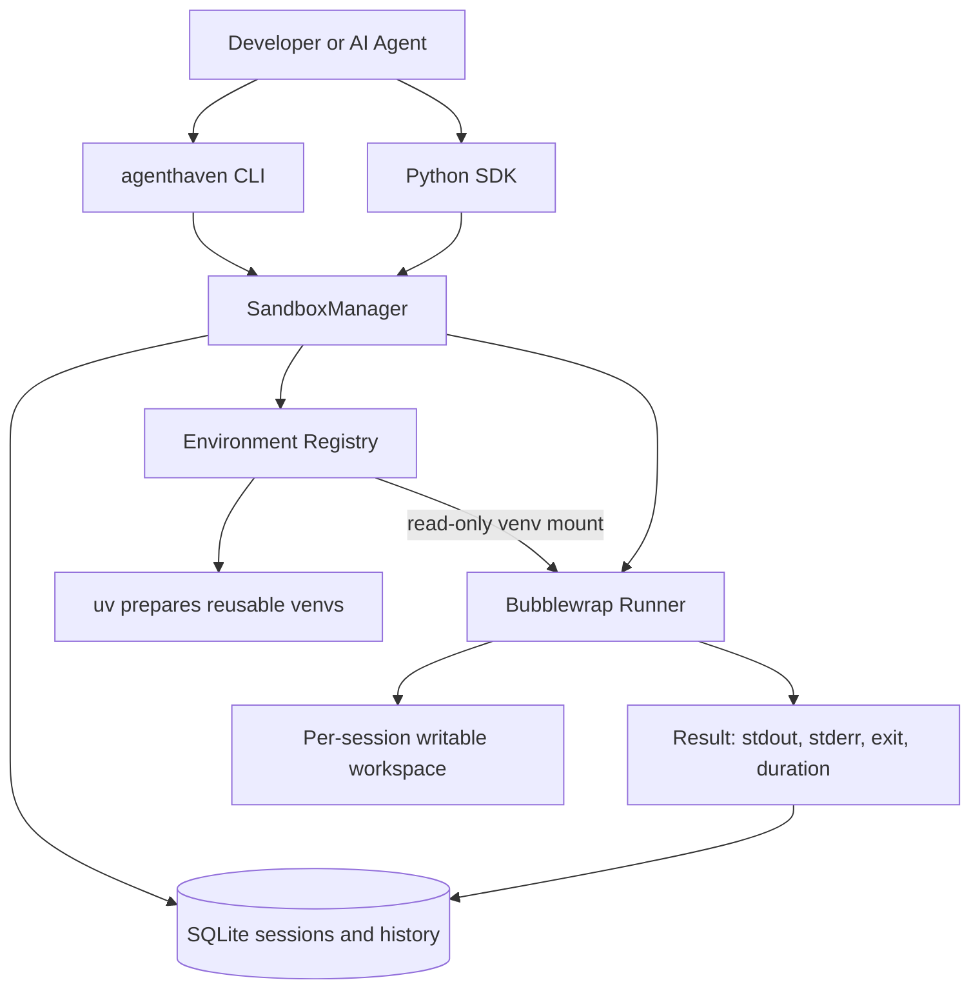

# AgentHaven

**Dockerless, local-first Python sandboxes — Python SDK + CLI with reusable dependency environments.**

AgentHaven creates isolated Python execution sessions on Linux using Bubblewrap. It supports multiple persistent sandboxes, text/binary artifact transfers, execution history, TTL-based cleanup, and a registry of reusable Python virtual environments prepared from `requirements.txt` files.

**No FastAPI server, no HTTP service, no Docker, and no AI-agent framework required.** Other Python applications (including AI agents) can use the SDK directly.

> [!WARNING]
> **Security status: LOCAL DEVELOPER PROTOTYPE — NOT A HARDENED UNTRUSTED-CODE SANDBOX.** AgentHaven uses Bubblewrap namespaces, limited mounts, disabled sandbox networking, execution timeouts, and per-process `prlimit` controls. These reduce accidental exposure but **do not guarantee containment of malicious code**. In particular, there are no enforced cgroup-v2 whole-process-tree quotas, no application-specific seccomp policy, and no hard disk quota. The sandbox shares the host kernel and the same OS user for writable workspace access. Dependencies are installed **outside** the sandbox by `uv`; do not allow untrusted agents to register packages automatically. Do not run as root or on a sensitive host with unreviewed generated code.
>
> **Security details:** [Security threat model](docs/SECURITY.md) · [Control-by-control security matrix](docs/SECURITY_MATRIX.md). Run `make security-audit` to inspect host capabilities and `make test-security` for regression probes. Neither command certifies malicious-code containment.

### Security at a glance

| Area | Current implementation | What it does **not** guarantee |
|---|---|---|
| Isolation | Bubblewrap Linux namespaces; restricted read-only system/runtime mounts; writable per-session workspace | No separate kernel, VM or OS-user boundary for workspace access |
| Network | Network namespace unshared for sandbox execution | No independently verified guarantee against every kernel or configuration escape |
| Resource controls | Wall-clock timeout plus `prlimit` CPU, address-space, file-size and file-descriptor limits | No enforced cgroup memory, PID, CPU or whole-process-tree budget |
| Workspace / artifacts | Per-session workspace, filename validation, bounded CLI/SDK transfers | No hard disk quota; no complete defense against hostile filesystem races |
| Reusable environments | `uv`-prepared virtual environments mounted read-only at execution | Package installation itself runs outside Bubblewrap; no trusted-package attestation |
| Logging | SQLite execution metadata, source hash and wall-time metrics | Not persistent stdout/stderr, CPU/RSS measurement or an immutable audit trail |
| Access | Local-only Python SDK and CLI | No multi-user authorization or remote API security model |

**Intended use:** a single trusted local developer testing reviewed code. A `-y` auto-approve flag in an example agent does not make generated code safe to execute.

## Features

- **Class-based Python SDK:** `SandboxManager`, `Sandbox`.
- **CLI:** create, inspect, execute, list, delete, upload, download, history, metrics, cleanup.
- **One-command tasks:** upload inputs → run a script → download outputs → automatically terminate.
- **Multiple sessions:** independent workspaces; scripts within the same session share files, not interpreter state. Executions are serialized to limit contention.
- **Dynamic environment registry:** create a reusable virtual environment with `uv`, list and inspect its installed packages, find compatible environments, and delete unused ones.
- **Built-in default:** `python-basic` uses Ubuntu's `/usr/bin/python3` and the standard library. `python-data` and `python-test` are legacy standard-library policies, **not** bundled pandas or pytest environments.
- **SQLite observability:** execution IDs, source hashes, duration, exit status, timeouts, truncation and p50/p95/p99 wall-clock metrics.
- **No daemon:** expired sessions are reclaimed when AgentHaven is used or `cleanup` runs, not continuously in the background.

## Architecture



For additional workflow diagrams, see [`docs/architecture.md`](docs/architecture.md) if present in your checkout.

## Requirements

- Ubuntu or compatible Linux; tested workflow on Ubuntu 24.04.
- `/usr/bin/python3`, `bubblewrap` (`bwrap`) and `prlimit` (from `util-linux`).
- [`uv`](https://docs.astral.sh/uv/) for the CLI/SDK installation and environment creation.
- A working unprivileged namespace configuration. Ubuntu can require a distribution-provided Bubblewrap AppArmor profile; **do not disable AppArmor globally**.

Install Linux prerequisites:

```bash
sudo apt-get update
sudo apt-get install -y python3 bubblewrap util-linux
```

Install `uv` using its [official instructions](https://docs.astral.sh/uv/getting-started/installation/) if it is not already available.

## Setup

From the repository root:

```bash
uv sync --extra dev
uv run agenthaven doctor
uv run agenthaven profiles
uv run agenthaven env list
uv run agenthaven run --env python-basic --code "print(2 + 2)"
make check
```

The repository's **host development `.venv`** is different from the **execution environments** in AgentHaven's registry. You do not need to activate `.venv` when running commands through `uv run`.

### Project layout

```text
agenthaven/
├── src/agenthaven/
│   ├── __init__.py
│   ├── cli.py
│   ├── manager.py
│   ├── environments.py
│   ├── runner.py
│   ├── store.py
│   └── models.py
├── input/
│   ├── sales.csv
│   ├── customers.csv
│   ├── analyze.py
│   ├── pandas_analysis.py
│   └── requirements-data.txt
├── output/                 # Generated/downloaded files
├── examples/
│   ├── sdk_demo.py
│   └── multi_sandbox_demo.py
├── tests/
├── docs/
│   ├── architecture.md
│   ├── SECURITY.md
│   └── SECURITY_MATRIX.md
├── Makefile
└── pyproject.toml
```

`input/` and `output/` are conventions for demo files, **not** special AgentHaven mounts. Inputs are explicitly uploaded by the CLI/SDK; outputs must be explicitly downloaded before a one-time sandbox is destroyed.

## Quick start: one-command execution

Place `analyze.py` and `sales.csv` in `input/`. The script should read `sales.csv` from its working directory and write `report.txt` there.

```bash
mkdir -p input output
uv run agenthaven run \
  --env python-data \
  --file input/analyze.py \
  --upload input/sales.csv \
  --download report.txt \
  --output-dir output/

cat output/report.txt
```

The CLI creates a temporary sandbox, uploads `sales.csv` under its **basename**, executes the script, attempts artifact downloads, and terminates the session even when execution fails. The requested output filename must exactly match what the script creates.

Run inline code without files:

```bash
uv run agenthaven run --env python-basic --code "print(sum(range(100)))"
```

For multiple inputs, supply `--upload` more than once. Likewise, use multiple `--download` options for multiple artifacts.

## Dynamic Python environments

Each environment is a **reusable virtual environment**, distinct from a sandbox session. Environment creation uses `uv` and may need internet access, but sandbox execution uses an isolated network namespace with no network access by default.

### 1. Define dependencies

Example `input/requirements-data.txt`:

```text
pandas
numpy
```

Unpinned versions are convenient for demonstrations. **Pin and review versions for reproducible projects**. Package resolution and installation can introduce supply-chain risks.

### 2. Create a registered environment

```bash
uv run agenthaven env create python-pandas \
  --requirements input/requirements-data.txt
```

This installs packages **once** in a cached virtual environment. Existing ready environments cannot simply be overwritten under the same name; create a new name/version or delete an unused environment and recreate it.

### 3. Discover installed capabilities

```bash
uv run agenthaven env list
uv run agenthaven env inspect python-pandas
uv run agenthaven env find --package pandas
uv run agenthaven env find --package pandas --package numpy
```

`env find` matches installed distribution names from the registry, **not semantic descriptions** such as “machine learning.” A registered environment may include additional transitive dependencies.

### 4. Execute in that environment

```bash
uv run agenthaven run --env python-pandas \
  --code "import pandas, numpy; print(pandas.__version__, numpy.__version__)"
```

For the full pandas example (requires `customer_id` in both CSV files):

```bash
uv run agenthaven run \
  --env python-pandas \
  --file input/pandas_analysis.py \
  --upload input/sales.csv \
  --upload input/customers.csv \
  --download report.csv \
  --download summary.json \
  --output-dir output/
```

This demonstrates actual third-party imports, CSV joining/aggregation, output artifacts and history recording. The Python environment is mounted read-only; execution writes only to the session workspace.

### 5. Delete an unused environment

```bash
uv run agenthaven env delete python-pandas
```

Deletion is refused while an active session references the environment. Deleted environments can be recreated from a requirements file.

> **Compatibility:** Registered environments currently use Ubuntu's `/usr/bin/python3` by default, which may have a different version from the Python interpreter used by `uv` for AgentHaven's own CLI. Virtual-environment symlinks and native packages can have platform dependencies. A successful `env create` only proves installation; verify actual imports with `agenthaven run --env ...`.

## Persistent sandbox sessions (CLI)

Use a persistent session when you need multiple executions or want to inspect files between commands.

```bash
uv run agenthaven create --env python-basic --ttl 300
```

Copy the `id` from the JSON output, then set:

```bash
SID="YOUR-SANDBOX-ID"

uv run agenthaven put "$SID" input/sales.csv
uv run agenthaven execute "$SID" --file input/analyze.py
uv run agenthaven files "$SID"
uv run agenthaven get "$SID" report.txt output/report.txt
uv run agenthaven history "$SID"
uv run agenthaven inspect "$SID"
uv run agenthaven delete "$SID"
```

Useful general commands:

```bash
uv run agenthaven list
uv run agenthaven list --status created
uv run agenthaven metrics --hours 24
uv run agenthaven cleanup
uv run agenthaven --help
uv run agenthaven run --help
uv run agenthaven env --help
```

The one-time `run` command is best for most tasks; persistent sessions are best for interactive or multistep workflows.

## Python SDK

You can embed AgentHaven into any Python application without starting a server.

```python
from agenthaven import SandboxManager

manager = SandboxManager()

print(manager.environments.list())
print(manager.environments.find(["pandas"]))

with manager.sandbox(profile="python-basic", ttl_seconds=300) as box:
    box.put_text("input.txt", "hello from AgentHaven")

    result = box.execute(
        "from pathlib import Path\n"
        "print(Path('input.txt').read_text())\n"
        "Path('result.txt').write_text('completed')\n"
    )

    print(result.stdout)
    print(result.stderr)
    print(result.exit_code, result.duration_ms, result.ok)
    print(box.get_text("result.txt"))
    print(box.files())
    print(box.history())

# Context manager terminates the session.
print(manager.metrics(hours=24))
```

To provision a reusable environment through the Python SDK (trusted operator only):

```python
manager.create_environment("python-pandas", "input/requirements-data.txt")
print(manager.environments.inspect("python-pandas"))
```

A long-lived sandbox can be created with `manager.create(profile="python-basic")`, revisited using `manager.get(sandbox_id)`, and later terminated with `.terminate()`. Multiple sandboxes can exist simultaneously, but execution is serialized by the local process lock to conserve resources.

### SDK artifact methods

The `Sandbox` class offers `put_text`, `get_text`, `put_bytes`, `get_bytes`, `upload`, `download`, `files`, and `delete_file`.

```python
with manager.sandbox(profile="python-basic") as box:
    box.upload("input/sales.csv")
    result = box.execute("from pathlib import Path; Path('done.txt').write_text('ok')")
    if result.ok:
        box.download("done.txt", "output/done.txt")
```

Create `output/` first if it does not exist. File names inside a sandbox are **flat** (`report.csv`, not `subdir/report.csv`); the library supports binary-safe transfers with a per-transfer size limit of 10 MiB. These are API limits, **not** hard disk-use quotas.

## Makefile shortcuts

The supplied Makefile supports the following developer workflows:

| Command | Description |
|---|---|
| `make install` | Install development dependencies |
| `make check` | Ruff lint + pytest |
| `make format` | Format Python source |
| `make doctor` | Verify Bubblewrap prerequisites |
| `make demo-basic` | Run simple built-in Python |
| `make demo-sdk` | SDK example |
| `make demo-multi` | Multiple independent sandbox sessions |
| `make demo-data` | Standard-library CSV analysis |
| `make env-data` | Register `python-pandas` (first time only) |
| `make demo-pandas` | Pandas CSV analysis with artifact downloads |
| `make env-list` | List registered environments |
| `make env-inspect ENV=python-pandas` | Inspect packages |
| `make env-find PACKAGE=pandas` | Find matching environment |
| `make env-delete ENV=python-pandas` | Delete an unused environment |
| `make run-script FILE=input/analyze.py` | Execute a script (without automatic uploads) |
| `make run-code CODE="print(42)"` | Run inline Python |
| `make sandboxes` | List sessions |
| `make create-sandbox PROFILE=python-basic` | Create a persistent session |
| `make history SID=<id>` | View execution history |
| `make metrics HOURS=24` | Historical execution metrics |
| `make cleanup` | Expire elapsed sessions |

Run `make help` for the complete menu. For multi-input tasks, use `make demo-pandas` or the explicit CLI command above; `make run-script` alone does not upload CSV inputs.

## Observability

Execution records are retained in SQLite after a sandbox is terminated. Fields include execution ID, sandbox ID, environment/profile, timestamp, source-code SHA-256 hash, exit code, wall-clock duration, timeout and output-truncation flags.

```bash
uv run agenthaven metrics --hours 24
uv run agenthaven history "$SID"
```

Metrics include execution counts, success/failure/timeout counts, success percentage and p50/p95/p99 duration. **CPU usage, peak RSS and comprehensive process-tree telemetry are not currently collected.** Full executed source, stdout and stderr are not retained in SQLite.

State and registered environments are typically located at:

```text
~/.local/share/agenthaven/
├── agenthaven.sqlite3
├── environments/
│   └── python-pandas/
│       ├── metadata.json
│       ├── requirements.txt
│       └── venv/
└── workspaces/
    └── <sandbox-id>/
```

Do not commit this state directory, virtual environments, secrets, `.env` files or user-generated artifacts to Git.

## Security verification and interpretation

Security controls and host capabilities are different concepts. `security-audit` reports which Linux features exist; it does **not** enable missing limits or prove isolation. Security regression tests exercise representative behaviors on the machine running them and may skip when Bubblewrap/user namespaces are unavailable.

```bash
make security-audit
make test-security
```

For each control, including whether it is configured, how to test it and what remains missing, see [`docs/SECURITY_MATRIX.md`](docs/SECURITY_MATRIX.md). For the threat model and responsible-use expectations, see [`docs/SECURITY.md`](docs/SECURITY.md).

If running agent-generated code, keep human review enabled and do not grant the agent environment-creation privileges. If you need to run hostile or fully autonomous unreviewed code, use a dedicated VM/microVM or another independently hardened isolation solution.

## Troubleshooting

**`uv run` cannot find `agenthaven`** — Run from the repository root, where `pyproject.toml` is present, and execute `uv sync --extra dev`. To install a command accessible from other directories, use `uv tool install --editable .` from the project root.

**`ImportError: cannot import name 'main'`** — Verify `src/agenthaven/cli.py` has `def main(argv=None)` and that `pyproject.toml` points its console script at `agenthaven.cli:main`. Run `uv run agenthaven --help`.

**`No such file or directory: sales.csv`** — Local `--upload` paths must exist. Use `--upload input/sales.csv`; inside the sandbox the file is named `sales.csv`.

**`KeyError: 'customer_id'` from pandas** — The pandas demo joins sales and customers on `customer_id`. Confirm both files include that column.

**Artifact download fails** — The script must create the named artifact in its working directory before the one-time sandbox terminates. Check `stderr` and exit code first.

**Registered environment exists but import fails** — Test `uv run agenthaven run --env ENV --code "import PACKAGE"`; inspect the registry with `env inspect`. `env create` does not itself verify Bubblewrap runtime compatibility.

**Bubblewrap namespace/AppArmor failure** — Run `uv run agenthaven doctor`. On Ubuntu, use supported Bubblewrap/AppArmor configuration; do not disable host namespace protections globally.

**`make check` tries importing FastAPI** — Remove obsolete tests from the older HTTP-server architecture. The current project has no FastAPI dependency.

**Creating an environment twice fails** — An environment name must be unique. Reuse it, delete it when unused, or create a new name (for example `python-pandas-v2`).

## Security and operational scope

- **Trusted local operator only:** no authentication or separate OS-user privilege boundary.
- **Network isolated during execution:** don't assume network access inside the sandbox, including for AWS SDK calls. Importing `boto3` works without accessing AWS.
- **Dependency setup is higher risk:** `uv` fetches packages during environment creation outside Bubblewrap; review and approve requirements before installation. `--only-binary` reduces source builds but not all supply-chain risks.
- **Read-only installed dependencies:** sandboxes receive a read-only environment mount and a writable workspace. Virtual environment mounting is not guaranteed to support every wheel or native dependency.
- **Incomplete limits:** process address-space and CPU resource limits are not whole-process-tree memory/CPU quotas; file transfer limits aren't disk quotas.
- **No background expiry daemon:** automatic TTL cleanup occurs when a manager starts or `cleanup` is called.
- **No remote or multi-tenant service:** do not expose this prototype for arbitrary users to execute code.

## Development

```bash
make format
make check
make demo-basic
make demo-multi
make demo-data
make metrics
```

After preparing the pandas environment:

```bash
make env-data        # only if python-pandas is not already registered
make demo-pandas
```

**Roadmap:** enforce cgroup-v2 limits and robust process-tree cleanup; add adversarial filesystem/isolation tests; improve environment versioning and dependency locking; add optional CPU/memory telemetry; expand package/runtime compatibility tests.

---

AgentHaven is designed as an **execution building block**, not an AI-agent framework: any Python caller can select a registered environment, create a sandbox, execute code, retrieve artifacts and inspect results without an HTTP server or Docker.
