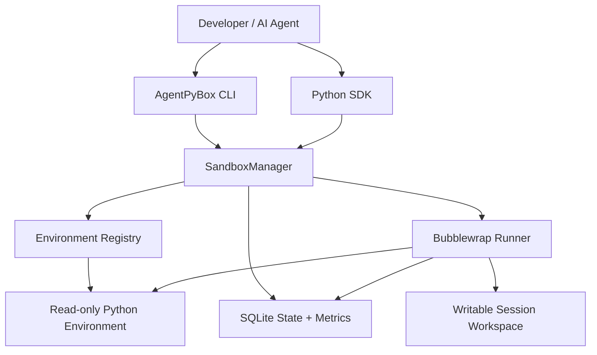
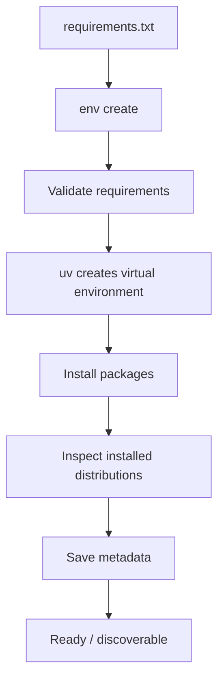
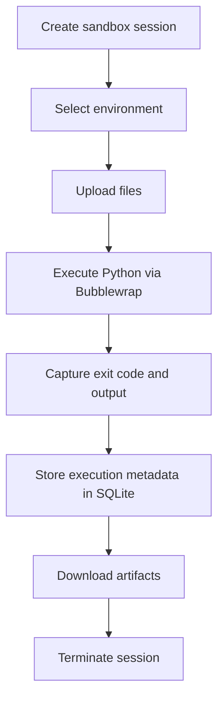

# AgentPyBox Architecture

AgentPyBox is a local-first, Dockerless Python execution
sandbox with a Python SDK and CLI.

It has no HTTP service or agent-framework dependency.

## High-level architecture

## Environment registration

Environment creation is an administrator/trusted-operator
operation. Third-party packages must not be installed
automatically in response to an untrusted agent instruction.

## Sandbox execution

Each execution starts a fresh Python interpreter.
Files remain available between executions in the same
active sandbox session.

## Separation of concerns

- Environment Registry: reusable Python dependencies.
- SandboxManager: lifecycle, state, locking and TTL.
- Runner: Bubblewrap isolation and execution.
- SQLite: sessions, history and metrics.
- CLI: user-friendly commands.
- Python SDK: integration with other Python applications.

## Security limitations

AgentPyBox is a local developer prototype, not a security-
certified isolation system.

- Bubblewrap shares the host kernel.
- Resource limits are not comprehensive process-tree quotas.
- The workspace is writable by sandboxed code.
- Dependencies are installed outside the execution sandbox.
- Arbitrary package installation requires operator approval.
- The registry should not be exposed to untrusted callers.
- No network service or multi-tenant authentication exists.
- Do not run hostile code or operate AgentPyBox as root.

## Observability

The SQLite execution history records execution IDs,
session IDs, environment identifiers, source hashes,
durations, exit codes, timeout flags and timestamps.

Aggregate metrics include success rate, failure count,
timeout count and execution-duration percentiles.

CPU usage and peak process-tree memory are not currently
measured.
